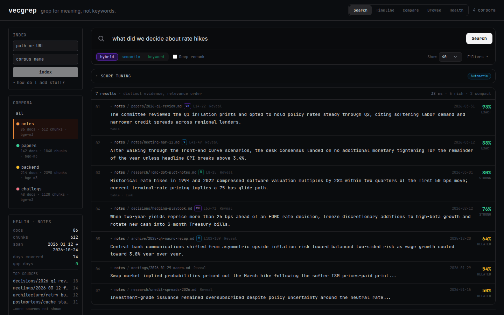
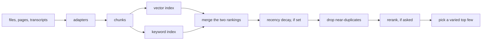

# vecgrep

Search your own files by meaning. vecgrep indexes notes, code, PDFs, web pages and chat logs on your machine, and answers from a vector index and a keyword index together. You can use it from the command line, over HTTP, in a web UI, or as an MCP server for an AI assistant.

[](pyproject.toml)
[](https://modelcontextprotocol.io/)
[](LICENSE)



The web UI has pages for search, timeline, compare, browse and health. Each result has a badge for the search that found it: V for the vector index, K for the keyword index, VK for both.

## A session

grep misses a passage when the author used different words. vecgrep finds it by meaning, and still catches an exact identifier.

```bash
$ vecgrep index ./my-notes --corpus notes
indexed: 86 doc(s), 612 chunk(s)

$ vecgrep search "what did we decide about rate hikes" --corpus notes --explain

[1]  96.3% exact    notes  /home/alice/my-notes/papers/2026-q1-review.md  [vector+bm25]
    explain: vec=0.680@#1 bm25=9.700@#1 rrf=0.0410
    We decided to pause rate hikes through Q2, citing softening labor demand.

[2]  81.8% strong   notes  /home/alice/my-notes/notes/meeting-mar-12.md  [vector]
    explain: vec=0.610@#2 rrf=0.0161
    The desk agreed to stop tightening for the rest of the year unless headline CPI breaks above 3.4%.
```

The second hit shares no words with the question. Only the vector index found it.

A question like "what happened?" wants events in order, not ranked passages. `timeline` cuts one slice from each of the best matching files and lists the messages by time. It expects transcripts where each message starts with a line like `**alice** · 14:02`. Any other file comes back as a plain slice.

```bash
$ vecgrep index ./chatlogs --corpus chatlogs --chunker turn_window
indexed: 12 doc(s), 340 chunk(s)

$ vecgrep timeline "what happened during the deploy" --corpus chatlogs

== /home/alice/chatlogs/ops/2026-10-24-deploy.md — 2026-10-24 ==
  14:02  alice: rolling api-gateway to 2026.10.24-rc2
  14:06  bob: connection pool saturation on replica-2, p99 at 1.8s
  14:09  alice: reverted pool max_idle to 32, latency back to 18ms
```

`compare` runs one query over two time windows and lists the sources that show up in only one.

## How it works



**Reading files.** A directory is walked recursively. Folders like `.git` and `node_modules` are skipped, and so is any file no adapter recognises. Adapters read plain text and code, Markdown, PDF text, web pages, Discord JSONL exports and the `conversations.json` export from Claude or ChatGPT. Images work once the optional visual extra is on ([docs/VISUAL_ENRICHMENT.md](docs/VISUAL_ENRICHMENT.md)). The default chunker takes three sentences and steps forward two. `--chunker` picks another: token windows, Markdown sections, code symbols or chat turns.

**Two searches, one ranking.** The vector side always returns its top 50, even when nothing matches, and that noise buries real keyword hits. So reciprocal rank fusion gives keyword hits a weight of 1.5. Much higher and keyword matches start to beat long, conceptual questions. The weight can be set for each corpus. Vector hits under a noise floor are dropped before the merge.

**Embeddings.** The default model is bge-m3 through Ollama. A corpus pins its model when it is created, so corpora built with different models sit side by side and each is queried with its own. If Ollama is down, vecgrep does not switch to OpenAI on its own. Mixing models would corrupt a corpus's vectors, and the calls cost money nobody asked for. To use OpenAI, move a corpus there on purpose with `vecgrep corpora migrate papers --to-backend openai`.

**Recency.** `vecgrep corpora decay` gives a corpus a half-life. A hit one half-life old scores half as much, and nothing is cut below that. Without the floor, an exact match on an old fact lost to a vague match on something recent. A document's date comes from a `date:` line, then its file name, then the file's modified time.

**Duplicates and reranking.** Overlapping windows and near-verbatim copies are collapsed. The last step picks results that differ from each other, so five hits are five pieces of evidence and not five slices of one conversation. `--rerank` rescores the top 50 candidates with a cross-encoder. The model loads in the background. If it is not ready after 5 seconds, or it fails, the search returns the merged ranking.

**Confidence.** The percentage on a hit is calibrated for each embedding model, so the same number means about the same thing whichever model made the vectors. The CLI and API label hits to match: exact from 95, strong from 75, related from 40. A hit found only by the keyword index is labelled lexical-only and held between 25 and 39, because a keyword score says nothing about meaning.

**Crashes.** Indexing changes the vector index, the keyword index and the corpus list. Before it starts, vecgrep writes down what it is about to do. If the process dies halfway, the next start finishes the change or puts the old state back.

## Install

The `vecgrep` package on PyPI is a different project. Install this one from GitHub with [uv](https://docs.astral.sh/uv/), on Python 3.10 or newer:

```bash
uv tool install "vecgrep[mcp] @ git+https://github.com/jeffbai996/vecgrep"
```

To try it without installing, run `uvx --from "vecgrep[mcp] @ git+https://github.com/jeffbai996/vecgrep" vecgrep --help`. The extras are `openai`, `rerank`, `watch`, `mcp`, `code`, `visual` and `dev`.

Pull the default embedding model with [Ollama](https://ollama.com) and start it:

```bash
ollama pull bge-m3
ollama serve
```

## Usage

```bash
vecgrep index ./my-docs --corpus papers            # incremental; --force re-embeds, --ephemeral keeps nothing on disk
vecgrep index https://example.com/article --corpus web
vecgrep watch ./my-docs --corpus papers            # re-index on change (--quiet-period 300 defers live-written files)

vecgrep search "rate hikes" --corpus papers --top 10
vecgrep search "rate hikes" --mode vector          # or --mode bm25; the default is hybrid
vecgrep search "rate hikes" --rerank
vecgrep search "rate hikes" --budget               # top 8 in full, then one-line stubs
vecgrep search "rate hikes" --filter "source:*2026*.md" --filter after:7d

vecgrep timeline "what happened during the deploy" --corpus chatlogs --filter after:7d
vecgrep compare "deployment failures" --corpus chatlogs --a-after 60d --a-before 30d --b-after 30d
vecgrep related <chunk-id> --corpus chatlogs
vecgrep chunk <corpus> <chunk_id>                  # expand a stub

vecgrep corpora list | delete <name> | export <name> --out f.tar.gz | import f.tar.gz --rename <name>
vecgrep corpora decay chatlogs --half-life 14      # or --off
vecgrep corpora bm25-weight notes --factor 2.0     # keyword weight for this corpus

vecgrep status [--json]
vecgrep doctor [--fix] [--json]
vecgrep backup create | list | verify <file> | restore <file> --confirm <id>
vecgrep serve                                      # web UI, /api/* and /mcp on 127.0.0.1:8765
vecgrep mcp                                        # MCP server over stdio
```

`vecgrep --help` lists the rest, and `vecgrep <command> --help` lists the options.

`--filter` can be repeated, and every filter must match. The forms are `date:`, `after:`, `before:`, `channel:`, `source:`, `source_path:`, `corpus:`, `speaker:`, `bot:true|false`, `has:code|table|link` and `meta.KEY=value`. A leading `-` excludes. A malformed date or an unknown value returns nothing, so a typo shows up as an empty answer.

## MCP server

`vecgrep mcp` speaks stdio. `vecgrep serve` serves the same 21 tools over HTTP at `/mcp`. Thirteen of them only read, among them `search`, `timeline`, `browse` and `get_chunk`. Eight write, and those are fenced in. Search presets (`lookup`, `explore`, `deep`) are in [docs/AGENT_SEARCH.md](docs/AGENT_SEARCH.md).

```bash
claude mcp add vecgrep --scope user -- vecgrep mcp                                    # stdio
claude mcp add --scope user --transport http vecgrep https://your-server.example/mcp  # remote HTTP
```

For Claude Desktop or Cursor, add `{"mcpServers": {"vecgrep": {"command": "vecgrep", "args": ["mcp"]}}}` to the client's MCP config.

An agent can read widely and change very little. The `propose_*` tools write an inert file under `$VECGREP_HOME/write/_pending`, and nothing is indexed until a person runs `vecgrep pending` and then `vecgrep confirm <proposal-id>`. Only one corpus accepts proposals unless `VECGREP_PROPOSE_ALLOWED_CORPORA` says otherwise. Direct `write` and `edit` are off until `VECGREP_DIRECT_WRITE_CORPUS=<name>` names the one corpus they may touch. They are capped, edits leave a backup, protected documents are refused, and nothing can be deleted directly. `write_temp` stores notes that expire on their own, once `VECGREP_TEMP_CORPUS` is set.

## Configuration

State lives in `~/.vecgrep`, or wherever `VECGREP_HOME` points, and only your user can read it. Settings come from environment variables first, then `config.json`, then the defaults in `vecgrep/backend/config.py`. The ones most people touch:

| Variable | Default | What it sets |
|---|---|---|
| `VECGREP_OLLAMA_URL` | `http://localhost:11434` | the embedding server |
| `VECGREP_OLLAMA_FALLBACK_URL` | unset | a second Ollama host, used when the first is down |
| `VECGREP_EMBED_MODEL` | `bge-m3` | the embedding model |
| `VECGREP_API_HOST`, `VECGREP_API_PORT` | `127.0.0.1`, `8765` | where `serve` listens |
| `VECGREP_API_TOKEN` | unset | bearer token for `/api/*` |
| `VECGREP_QDRANT_URL` | unset | use a Qdrant server instead of the embedded store |

The embedded Qdrant store allows one process at a time. If you run `serve`, `watch` and CLI commands together, set `VECGREP_QDRANT_URL` so they share one server.

`vecgrep serve --host 0.0.0.0` refuses to start without an API token of 32 characters or more. Put TLS in a reverse proxy in front of it. To let a public MCP client such as Claude.ai connect, turn on the built-in OAuth 2.1 server and keep vecgrep itself on loopback. [docs/OAUTH.md](docs/OAUTH.md) has the setup.

## Development

```bash
pip install -e ".[dev]"
pytest
```

The tests use a fresh `VECGREP_HOME` each and a stub embedding backend, so they need neither Ollama nor a network. [docs/DEVELOPING.md](docs/DEVELOPING.md) covers the structure. See also [CHANGELOG.md](CHANGELOG.md), [docs/IDEAS.md](docs/IDEAS.md) and [CONTRIBUTING.md](CONTRIBUTING.md).

## License

[MIT](LICENSE)
