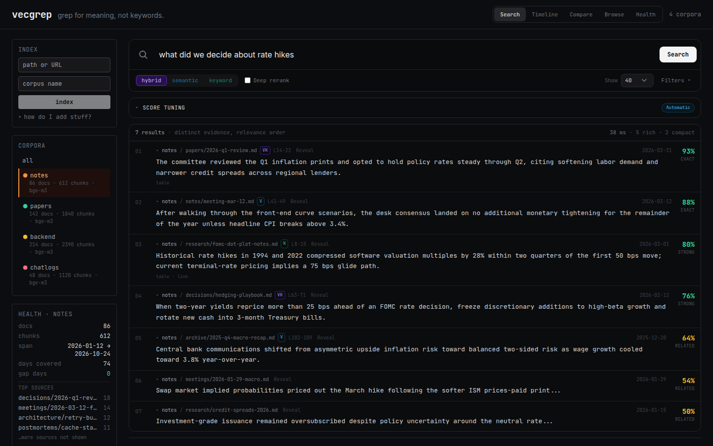

# vecgrep

Local-first semantic search over files, source code, PDFs, URLs, and chat transcripts. It runs hybrid BM25 + vector retrieval on your machine and exposes the same index through a CLI, an HTTP API, a web UI, and an MCP server.



Five workspaces in the web UI (`Search`, `Timeline`, `Compare`, `Browse`, `Health`), showing hybrid results with retriever badges (`VK` both, `V` semantic, `K` keyword), line anchors, and per-corpus health.

## What a session looks like

Keyword `grep` misses a passage when the author used different words. Embedding libraries (`txtai`, `chroma`, `LlamaIndex`) require writing Python before you can ask a question. `vecgrep` is a binary you point at a folder:

```bash
$ vecgrep index ./my-notes --corpus notes
indexed: 86 doc(s), 612 chunk(s)

$ vecgrep search "what did we decide about rate hikes" --corpus notes --explain
[1]  92.4% exact    notes  papers/2026-q1-review.md  [vector+bm25]
    explain: vec=0.780@#1 bm25=14.200@#1 rrf=0.0409
    ... ## Policy rate trajectory
    The committee reviewed the Q1 inflation prints and opted to hold policy
    rates steady through Q2, citing softening labor demand and narrower
    credit spreads across regional lenders.
    Further tightening remains contingent on core services ...

[2]  88.1% exact    notes  notes/meeting-mar-12.md  [vector]
    explain: vec=0.745@#2 rrf=0.0161
    ... ### Desk Macro Notes
    After walking through the front-end curve scenarios, the desk consensus
    landed on no additional monetary tightening for the remainder of the year
    unless headline CPI breaks above 3.4%.
    Duration hedges stay at 65% of the target allocation ...
```

When a question is "what happened?" rather than "which chunk matches?", `timeline` reconstructs contiguous chronological slices grouped by source file, and `compare` diffs two time windows for the same query:

```bash
$ vecgrep timeline "what happened during the deploy" --corpus chatlogs --filter after:7d
== ops/deploy-2026-10.jsonl — 2026-10-24 ==
  14:02  alice: rolling api-gateway to 2026.10.24-rc2
  14:06  bob: connection pool saturation on replica-2, p99 at 1.8s
  14:09  alice: reverted pool max_idle to 32; latency back to 18ms

$ vecgrep compare "connection pool saturation" --corpus chatlogs \
    --a-after 60d --a-before 30d --b-after 30d
```

## How it works

```
                          ┌──▶ vector (qdrant) ──┐
docs ──▶ adapters ──▶ chunkers ──┤                      ├──▶ RRF ──▶ [decay] ──▶ dedup/MMR ──▶ [rerank] ──▶ top-k
                          └──▶ bm25 (inverted) ──┘
```

- **Adapters and chunkers.** Directories are walked recursively; each file goes to a matching adapter and unrecognized files are skipped. `--chunker` on `index` and `watch` selects `sentence_window` (default: 3 sentences, stride 2), `fixed_token` (256 `cl100k_base` tokens, 32 overlap), `markdown_section` (keeps windows inside one heading section), `code_symbol` (splits Python and TypeScript at definitions; TypeScript requires the `code` extra), or `turn_window` (4 chat turns, stride 3). `--include '*.md'` restricts directory indexing to matching filenames.

| Adapter | Inputs |
|---|---|
| `plaintext` | `.txt`, `.log`, `.csv`, `.tsv`, `.rst`, `.org`, `.tex`, `.srt`, extensionless, plus code (`.py`, `.ts`, `.js`, `.go`, `.rs`, `.java`, `.c`, `.cpp`, `.sh`, etc.), config (`.json`, `.yaml`, `.toml`, `.ini`, `.env`), markup (`.html`, `.xml`, `.css`), and schemas (`.sql`, `.graphql`, `.proto`) |
| `markdown` | `.md`, `.markdown`, `.mdx` |
| `pdf` | `.pdf` (text layer; scanned PDFs need OCR or the `visual` extra) |
| `url` | `http://`, `https://` (strips scripts and boilerplate, keeps prose) |
| `discord_jsonl` | `.jsonl`, one message per line with `author` and `content` |
| `claude_export`, `chatgpt_export` | `conversations.json` from the provider's data export |
| `image` | `.png`, `.jpg`, `.jpeg`, `.webp`, `.tif`, `.tiff`, `.bmp` (requires `visual`; see [docs/VISUAL_ENRICHMENT.md](docs/VISUAL_ENRICHMENT.md)) |

- **Hybrid retrieval.** Vector search and BM25 each return up to 50 candidates. Sub-noise vector hits below the model's cosine floor are dropped, and the remaining ranks are fused with Reciprocal Rank Fusion (`score = Σ w / (60 + rank + 1)`). BM25's default weight is `1.5` (`VECGREP_BM25_WEIGHT`, or per-corpus via `vecgrep corpora bm25-weight`), high enough for exact identifiers to clear vector noise on short queries without crowding out semantic matches on long ones. The BM25 tokenizer splits `snake_case` and `camelCase` identifiers and emits CJK bigrams.
- **Per-corpus pinned embeddings.** Default embedding is Ollama `bge-m3` (1024-dim). Each corpus pins its backend, model, and vector dimension at creation; corpora built with different models coexist and query with their own model. `VECGREP_OLLAMA_FALLBACK_URL` provides automatic failover to a second Ollama host serving the same model, and `VECGREP_OLLAMA_OVERFLOW_URL` offloads bulk indexing batches. `vecgrep` never fails over automatically from Ollama to OpenAI, because switching embedding models mid-corpus would corrupt its vector space and make unrequested metered calls. To use OpenAI (`text-embedding-3-small`, 1536-dim), migrate or pin the corpus explicitly with `vecgrep corpora migrate <name> --to-backend openai`.
- **Recency decay.** `vecgrep corpora decay <name> --half-life N` multiplies a hit's fused score by `max(0.5, 0.5 ** (age_days / half_life))` before the top-k cut (`VECGREP_DECAY_FLOOR` defaults to `0.5` so older exact matches are not zeroed out). Document dates (`doc_timestamp`) are parsed at index time from frontmatter/header lines (`date:`, `saved:`, `created:`, `timestamp:`), then `YYYY-MM-DD` filenames, then file `mtime`. Undated chunks are not penalized.
- **Deduplication, MMR, and reranking.** Overlapping windows from the same source and near-verbatim clones are collapsed before truncation, and Maximal Marginal Relevance (`λ = 0.7`) favors distinct evidence. Passing `--rerank` rescores the top 50 fused candidates with `BAAI/bge-reranker-v2-m3` (`VECGREP_RERANKER`). The cross-encoder warms outside the request path; if it is still warming after 5 seconds or fails, search returns the hybrid ranking and marks hits as not reranked.
- **Calibrated confidence.** Ranking uses the fused (or reranked) score, while the displayed `%` is passed through a per-model sigmoid so `90%+` (`exact` / `strong`) means the same thing across embedding models. BM25-only hits have no cosine and are scaled into a dedicated lexical band (`25%–39%` on the server, labeled `lexical-only`).
- **Transcript and memory retrieval.** `--budget` returns the top `full_k` (default 8) hits with surrounding context plus a token-capped tail of one-line stubs expandable with `vecgrep chunk <corpus> <chunk_id>`. Entity aliases in `VECGREP_ALIASES_FILE` expand across nicknames, handles, and languages at query time.

## Install

The `vecgrep` package on PyPI is unrelated. Install from GitHub with [uv](https://docs.astral.sh/uv/) (Python 3.10+):

```bash
uv tool install "vecgrep[mcp] @ git+https://github.com/jeffbai996/vecgrep"
```

One-shot isolated run without installing:

```bash
uvx --from "vecgrep[mcp] @ git+https://github.com/jeffbai996/vecgrep" vecgrep --help
```

Optional extras in `pyproject.toml` (combine inside the brackets): `openai`, `rerank`, `watch`, `mcp`, `code`, `visual`, `dev`.

Pull and serve the default embedding model with [Ollama](https://ollama.com):

```bash
ollama pull bge-m3
ollama serve
```

## Usage

```bash
vecgrep index ./my-docs --corpus papers            # incremental; --force re-embeds, --ephemeral keeps nothing on disk
vecgrep index https://example.com/article --corpus web
vecgrep watch ./my-docs --corpus papers            # re-index on change (--quiet-period 300 defers live-written files)
vecgrep watch ./a --also-watch ./b --corpus cli    # multiple directories feeding one corpus

vecgrep search "rate hikes" --corpus papers --top 10
vecgrep search "rate hikes" --mode vector          # or --mode bm25; default is hybrid
vecgrep search "rate hikes" --rerank               # cross-encoder rescoring
vecgrep search "rate hikes" --explain              # per-retriever score breakdown
vecgrep search "rate hikes" --budget               # top 8 in full + token-capped one-line stubs
vecgrep search "rate hikes" --watch --interval 5   # re-run and diff matching source IDs
vecgrep search "rate hikes" --filter "source:*2026*.md" --filter after:7d

vecgrep timeline "what happened during the deploy" --corpus chatlogs --filter after:7d
vecgrep related <chunk-id> --corpus chatlogs
vecgrep compare "deployment failures" --corpus chatlogs --a-after 60d --a-before 30d --b-after 30d
vecgrep stats chatlogs
vecgrep summarize chatlogs --after 7d
vecgrep chunk <corpus> <chunk_id>

vecgrep corpora list | delete <name> | export <name> --out f.tar.gz | import f.tar.gz --rename <name>
vecgrep corpora migrate papers --to-backend openai --to-model text-embedding-3-small
vecgrep corpora decay chatlogs --half-life 14      # or --off
vecgrep corpora weight notes --factor 1.5          # cross-corpus rank multiplier
vecgrep corpora bm25-weight notes --factor 2.0     # per-corpus BM25 fusion weight
vecgrep corpora context notes --description "Architecture decisions" --use-for "design history"

vecgrep cache stats | clear --identity ollama:bge-m3 | sweep --dry-run | compact
vecgrep bm25 rebuild <corpus>
vecgrep temp sweep

vecgrep status [--json]                            # daemon, auth, per-corpus counts
vecgrep doctor [--fix] [--require-healthy] [--json]
vecgrep backup create | list | verify <file> | restore <file> --confirm <id>
vecgrep config [--json]                            # effective settings
vecgrep init --yes                                 # write config.json
vecgrep serve                                      # web UI, /api/* and /mcp on 127.0.0.1:8765
vecgrep mcp                                        # MCP server over stdio
```

Run `vecgrep <command> --help` for all options.

### Filters

`--filter` is repeatable and ANDed: `date:<YYYY-MM-DD|today|yesterday>`, `after:<iso|7d|24h|2w>`, `before:<iso|today>`, `channel:<name>`, `source:<glob>`, `source_path:<glob>`, `corpus:<name>`, `speaker:<name>` (alias `author:`), `bot:true|false`, `has:code|table|link`, `meta.KEY=<value>`. Prefix any filter with `-` to exclude (`-corpus:scratch`). Recognized filters fail closed: a malformed date or unknown value returns zero results rather than being ignored.

## MCP server and guarded writes

`vecgrep mcp` serves stdio; `vecgrep serve` mounts streamable stateless HTTP at `/mcp` alongside `/api/*`. Intent presets (`lookup`, `explore`, `deep`) and evidence expansion are documented in [docs/AGENT_SEARCH.md](docs/AGENT_SEARCH.md).

The **21 MCP tools** grouped by intent:

| Intent | Tools |
|---|---|
| Find evidence | `search`, `timeline`, `incident`, `browse`, `related`, `compare` |
| Expand and inspect | `get_chunk`, `get_source`, `stats`, `summarize_corpus` |
| Discover corpora | `list_corpora`, `get_corpus` |
| Direct mutation | `write`, `edit`, `write_temp`, `renew_temp` |
| Human-confirmed mutation | `propose_write`, `propose_edit`, `propose_delete`, `propose_merge` |

- `browse` requires at least one selector (`channel`, `date`, `since`/`until`, or `source_path`) and refuses whole-corpus dumps.
- When the caller omits `rerank`, MCP enables it automatically once the target corpus (or unscoped fan-out total) has at least 10,000 chunks. When the caller omits `budget`, MCP enables breadth mode automatically on a single named corpus with at least 10,000 chunks (unscoped searches keep their flat response shape unless `budget=true` is passed).

```bash
claude mcp add vecgrep --scope user -- vecgrep mcp                                    # stdio
claude mcp add --scope user --transport http vecgrep https://your-server.example/mcp  # remote HTTP
```

For Claude Desktop or Cursor, add `{"mcpServers": {"vecgrep": {"command": "vecgrep", "args": ["mcp"]}}}` to the client's MCP config (pass `VECGREP_OLLAMA_URL` in `"env"` when Ollama runs on another host).

### Writing

Read access is broad; mutation is narrow:

1. **Propose, review, confirm (default):** `propose_write`, `propose_edit`, `propose_delete`, or `propose_merge` writes an inert JSON proposal under `$VECGREP_HOME/write/_pending`. Review with `vecgrep pending`, commit and index with `vecgrep confirm <proposal-id>` (pass `--ack <doc-id>` when confirming a protected document), or drop with `vecgrep discard <proposal-id>`. Proposal corpora are default-deny: only `VECGREP_DEFAULT_PROPOSE_CORPUS` (`claude-ai`) is open unless widened with comma-separated `VECGREP_PROPOSE_ALLOWED_CORPORA`. `propose_edit` supports full overwrite, a unique `old_str` -> `new_str` patch, or a metadata-only tag/source-kind update. `propose_merge` synthesizes two or more documents into the first ID and deletes the absorbed IDs only upon confirmation.
2. **Direct write (opt-in, one corpus):** `VECGREP_DIRECT_WRITE_CORPUS=<name>` enables immediate MCP `write` and `edit` for that corpus only (the corpus parameter is omitted from the tool schema so callers cannot redirect writes). Capped by `VECGREP_DIRECT_WRITE_MAX_BYTES` (64 KB) and `VECGREP_DIRECT_WRITE_MAX_PER_HOUR` (30); edits keep timestamped backups and refuse protected documents; there is no direct delete.
3. **Expiring scratch documents (opt-in, one corpus):** `VECGREP_TEMP_CORPUS=<name>` enables MCP `write_temp` and `renew_temp` on a separate corpus. Each entry requires an expiry (`3d`, `12h`, `2w`, or ISO date) up to `VECGREP_TEMP_MAX_TTL_DAYS` (default 90). Expired entries are hidden at search time and purged by `vecgrep temp sweep` or the next temp write.
4. **Local CLI writes:**

```bash
vecgrep write notes "A durable note" --source-kind fact --tag example
vecgrep edit notes-<id> "Replacement body" --corpus notes
```

## Storage and configuration

State lives under `VECGREP_HOME` (default `~/.vecgrep`, created with mode `0700`):

| Path | Contents |
|---|---|
| `qdrant/` | Embedded Qdrant collections, one per corpus |
| `bm25/` | Per-corpus `.pkl` or SQLite FTS5 `.db` sidecar (`VECGREP_BM25_BACKEND`) |
| `embed_cache.db` | SQLite float32 embedding cache keyed by `(backend, model, text_hash)` |
| `locks/` | Cross-process `flock` files for per-corpus and registry leases |
| `mutations/` | Per-corpus atomic crash-recovery intent journal (normally empty) |
| `write/` | Written Markdown documents and `_pending/` proposals |
| `backups/` | Verified `.vgbak` archives |
| `corpora.json`, `config.json` | Corpus registry and optional non-secret settings |

Search acquires a shared corpus lease (`VECGREP_SEARCH_LOCK_TIMEOUT_S`, default 10s); indexing, deletion, and writes acquire an exclusive lease. Before mutating Qdrant, BM25, and `corpora.json`, `vecgrep` records an `fsync`ed intent in `mutations/<corpus>.json` and rolls interrupted work backward or forward on startup.

Precedence is environment variables, then `~/.vecgrep/config.json`, then defaults (`vecgrep/backend/config.py`):

| Variable | Default | Purpose |
|---|---|---|
| `VECGREP_HOME` | `~/.vecgrep` | Storage root |
| `VECGREP_OLLAMA_URL`, `VECGREP_OLLAMA_FALLBACK_URL`, `VECGREP_OLLAMA_OVERFLOW_URL` | `http://localhost:11434`, unset, unset | Primary, failover, and bulk-index Ollama endpoints |
| `VECGREP_OLLAMA_NUM_BATCH` | unset | Optional Ollama runner batch cap to bound working memory |
| `VECGREP_EMBED_MODEL`, `VECGREP_OPENAI_EMBED_MODEL`, `OPENAI_API_KEY` | `bge-m3`, `text-embedding-3-small`, unset | Embedding models and OpenAI credential (used when a corpus pins `openai`) |
| `VECGREP_API_HOST`, `VECGREP_API_PORT` | `127.0.0.1`, `8765` | HTTP bind address and port |
| `VECGREP_API_TOKEN`, `VECGREP_ADMIN_TOKEN` | unset, unset | Bearer tokens for `/api/*` (32+ chars required for non-loopback bind) and `/api/admin/*` |
| `VECGREP_REST_ALLOWED_HOSTS` | unset | Comma-separated `host:port` values for a trusted tokenless REST reverse proxy |
| `VECGREP_QDRANT_URL` | unset | Qdrant server URL (e.g. `http://localhost:6333`) for concurrent multi-process access |
| `VECGREP_BM25_BACKEND`, `VECGREP_BM25_WEIGHT`, `VECGREP_BM25_COVERAGE_MODE` | `pickle`, `1.5`, `penalty` | BM25 store (`pickle` or `sqlite`), RRF weight, partial-match handling (`penalty` or `filter`) |
| `VECGREP_EMBED_CACHE_MAX_ROWS` | `500000` | LRU row cap on `embed_cache.db` (`<= 0` disables) |
| `VECGREP_TOP_K`, `VECGREP_THREAD_POOL_SIZE`, `VECGREP_SEARCH_LOCK_TIMEOUT_S` | `5`, `8`, `10.0` | Default result count, AnyIO worker cap, per-corpus search lock timeout |
| `VECGREP_ALIASES_FILE` | `$VECGREP_HOME/aliases.json` | Entity alias map; see `docs/aliases.example.json` |
| `VECGREP_OAUTH_*`, `VECGREP_MCP_ALLOWED_HOSTS`, `VECGREP_MCP_ALLOWED_ORIGINS` | off (`8766` public port) | OAuth 2.1 for public remote MCP clients; see [docs/OAUTH.md](docs/OAUTH.md) |
| `VECGREP_DEFAULT_PROPOSE_CORPUS`, `VECGREP_PROPOSE_ALLOWED_CORPORA`, `VECGREP_PROPOSE_HOOK`, `VECGREP_DIRECT_WRITE_*`, `VECGREP_TEMP_*` | `claude-ai`, unset | MCP write and temp-corpus controls |

### Remote access and backups

- `vecgrep serve --host 0.0.0.0` refuses to start without a 32+ character `VECGREP_API_TOKEN`. Without a token, `/api/*` accepts only loopback `Host` headers on `VECGREP_API_PORT`. Terminate TLS in a reverse proxy.
- For public remote MCP clients (such as Claude.ai), set `VECGREP_OAUTH_ENABLED=1`, `VECGREP_OAUTH_ISSUER_URL`, and a 32+ character `VECGREP_OAUTH_APPROVAL_TOKEN`. Keep `vecgrep` on loopback and route public MCP/OAuth paths to `VECGREP_OAUTH_PUBLIC_PORT` (`8766`), leaving local clients on `8765`. Details: [docs/OAUTH.md](docs/OAUTH.md).
- Whole-instance backups (`vecgrep backup create | list | verify | restore`) snapshot Qdrant collections, `corpora.json`, non-secret config, aliases, and write-through docs. Restore verifies checksums, requires `--confirm <backup-id>`, takes a pre-restore safety backup, rebuilds BM25 from Qdrant payloads, and rolls back on failure.

## Operational notes

- **Embedded Qdrant allows one process at a time.** When running `serve`, `watch`, and CLI commands concurrently, set `qdrant_url` in `config.json` so every process shares one Qdrant server rather than splitting across embedded and remote stores.
- **BM25 SQLite backend.** Convert and verify sidecars before switching `bm25_backend` to `sqlite`. Stale `.pkl` files block startup in `sqlite` mode, and store/index drift blocks lexical search until `vecgrep bm25 rebuild <corpus>` runs.
- **Duplicate path aliases.** After a directory move or symlink change, `vecgrep doctor` reports multiple source IDs resolving to one file. `--fix` does not pick which ID to delete: normalize the ingestion path, confirm coverage, and delete legacy IDs via `VecgrepService.delete_source` (indexing a single file cleans up its old alias automatically).
- **Embedding cache cap.** Keep `embed_cache_max_rows` in `config.json` above the total distinct chunks across all corpora so repairs do not re-embed evicted rows.

## Development

```bash
pip install -e ".[dev]"
pytest
```

Tests run hermetically with a per-test `VECGREP_HOME` and a deterministic stub embedding backend (no Ollama or network access). Architecture and extension points: [docs/DEVELOPING.md](docs/DEVELOPING.md). Release history: [CHANGELOG.md](CHANGELOG.md). Candidate ideas: [docs/IDEAS.md](docs/IDEAS.md). Contributions: [CONTRIBUTING.md](CONTRIBUTING.md).

## License

[MIT](LICENSE)
